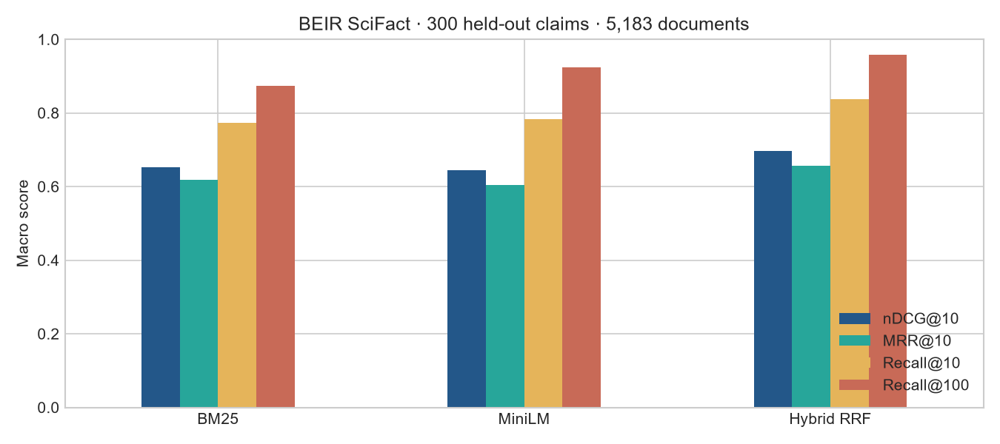
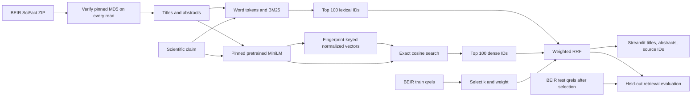

# Evidence Lens

Find scientific abstracts relevant to a claim, and compare lexical retrieval with a pretrained neural encoder. Evidence Lens searches the complete **5,183-document BEIR SciFact corpus** using BM25, MiniLM cosine similarity, or development-selected reciprocal rank fusion (RRF).

**This is retrieval, not claim verification.** It does not generate answers, classify support/refutation, determine truth, or provide medical advice. No LLM or model fine-tuning is involved.

## Measured results

All **300 BEIR SciFact test claims**, with **809 BEIR train claims used only for hybrid selection**:

| Method | nDCG@10 | MRR@10 | Recall@10 | Recall@100 |
|---|---:|---:|---:|---:|
| BM25 | 0.6519 | 0.6186 | 0.7740 | 0.8731 |
| Pretrained MiniLM | 0.6451 | 0.6047 | 0.7833 | 0.9250 |
| Hybrid RRF | **0.6967** | **0.6573** | **0.8374** | **0.9577** |

MiniLM alone does not beat BM25 on early-rank quality here, but improves deeper recall. The hybrid has the highest observed scores among these three predefined methods. These are descriptive benchmark results, not statistically established superiority or production guarantees.

The selected policy is **k=10, dense weight=0.5**, combining each retriever's top 100 candidates. Nine settings were compared using **train nDCG@10 only**. The selection is saved before loading test judgments. No test-directed retuning is implemented. BEIR's labeled test split corresponds to the original SciFact labeled development set—not its hidden test.



- [Executed, step-by-step notebook](notebooks/01_evidence_retrieval.ipynb)
- [Exact metrics, timings and provenance](outputs/report.json)
- [Development grid](outputs/development_grid.csv), [per-query errors](outputs/per_query.csv), [ranked IDs](outputs/test_rankings.json)
- [System design](docs/design.md) · [sources and licensing](docs/sources-and-licenses.md)

## Run locally

Python 3.11. Create an isolated environment; do not replace another application's PyTorch installation.

```bash
python -m venv .venv
# Linux/macOS:
source .venv/bin/activate
# Windows Git Bash instead:
# source .venv/Scripts/activate
# Windows PowerShell instead:
# .venv\Scripts\Activate.ps1

python -m pip install torch==2.8.0 --index-url https://download.pytorch.org/whl/cpu
python -m pip install -r requirements.txt
python -m evidence_lens.experiment
python scripts/execute_notebook.py
python -m streamlit run streamlit_app.py
```

First execution downloads the public dataset and the pinned model from Hugging Face. No account/API key is required. An existing supported CUDA installation is used automatically; otherwise four CPU torch threads are used. Model loading and corpus encoding are one-time costs while compatible caches exist. The reproducible CPU installation above does not install a CUDA runtime.

Try `Vitamin D deficiency causes rickets.` The app displays five ranked titles, **full source abstracts**, BEIR corpus IDs, and dataset/paper citation links. We do not assume those IDs map to a valid external paper URL. Scores are not calibrated probabilities; even irrelevant but valid queries return candidates.

## What runs



The pipeline uses exact vector search, not a vector database: this collection is small enough to keep a 5,183 × 384 float32 matrix in memory. Both retrievers consume `title + space + abstract`. BM25 uses lowercase Unicode word tokens and `rank_bm25` defaults; MiniLM normalizes embeddings so dot product equals cosine similarity. No stemming, learned reranker, chunking, generation, or document ingestion service is implemented.

### Reproducibility and evaluation

- Archive MD5: `5f7d1de60b170fc8027bb7898e2efca1`, verified against the [public BEIR README](https://github.com/beir-cellar/beir#beers-available-datasets). Download and cached archive bytes are checked; records are read directly from the verified ZIP.
- Model: `sentence-transformers/all-MiniLM-L6-v2`, HF API revision `1110a243fdf4706b3f48f1d95db1a4f5529b4d41`.
- Embedding cache key hashes the complete ordered input text, model ID/revision, maximum length, normalization policy, and encoder/runtime versions. Raw data, models, vectors and local environments are ignored by git.
- Query/document rankings break score ties lexicographically by corpus ID. The development grid breaks objective ties by lower k, then lower dense weight.
- Metrics macro-average over **all qrels queries**. Missing rankings score zero. Recall divides by all judged relevant documents; unjudged documents count as nonrelevant. nDCG uses exponential gain and logarithmic discount. No support/refutation labels are inferred.
- The notebook independently reruns retrieval and checks its scores against `report.json`; it does not merely display a saved table.

### Timing

`outputs/report.json` records real wall-clock timings and whether corpus embeddings came from cache: model loading, BM25 indexing, corpus encoding/cache load, development retrieval, test retrieval and fusion. Query timings are **batched throughput over the entire split**, not single-request latency. The UI measures a warm individual request, including both retrievers. Hardware, cache state and concurrency materially affect these numbers; no latency SLA is claimed.

## Important limitations

- **3,681 of 5,183 title/abstract inputs exceed 256 wordpieces.** MiniLM truncates them; only the UI shows the full abstract. This can miss late evidence. Chunking is a future alternative, not an implemented feature.
- Two held-out normalized claim texts overlap train (`870`, `1292`). Official splits are preserved; a **298-query non-overlap sensitivity evaluation** is in the report. Hybrid nDCG@10 there is 0.6980. Normalization is lowercase word tokens joined with spaces.
- Model pretraining includes scientific citation pairs. Upstream overlap cannot be ruled out; revision pinning does not establish pretraining decontamination.
- This is an English scientific/biomedical benchmark, not current clinical literature. Qrels are incomplete and most queries have only one judged relevant document.
- The 300 test qrel sets match the original claims' cited-document IDs, including 112 claims without annotated support/contradiction evidence. Successful retrieval means recovering citation targets, not finding proof. See the [independent audit](docs/independent-audit.md).
- Local app only: no authentication, rate limits, multi-user load testing, online ingestion, access control, or production monitoring. Public deployment needs additional engineering.

## Tests and CI

```bash
python -m pytest tests -m 'not integration' -q
# Requires real downloaded corpus/model plus outputs/selection.json:
RUN_INTEGRATION=1 python -m pytest tests -q
# PowerShell: $env:RUN_INTEGRATION = '1'; python -m pytest tests -q
python scripts/execute_notebook.py
```

Tests cover metric denominators, deterministic ties, malformed queries, modified-data/revision cache keys, archive corruption, fusion ordering, train-only selection, and actual Streamlit AppTest submission/results. CI explicitly installs CPU PyTorch, runs offline unit tests, executes the complete network-backed experiment, tests the app on real data and executes the notebook. It has a 20-minute timeout; a successful local run is not a claim that remote CI has already passed. The workflow uploads results and the executed notebook.

## Layout

```text
evidence_lens/        data integrity, retrieval, metrics, experiment
notebooks/           executed research walkthrough
outputs/             metrics, rankings, diagnostics, figures
scripts/             notebook generation and fresh-kernel execution
tests/               unit tests and real Streamlit integration
streamlit_app.py      local search interface
docs/                system design and source/license notes
```

## Attribution

SciFact: Wadden et al., [Fact or Fiction: Verifying Scientific Claims](https://aclanthology.org/2020.emnlp-main.609/), EMNLP 2020. BEIR: Thakur et al., [BEIR: A Heterogeneous Benchmark for Zero-shot Evaluation of Information Retrieval Models](https://arxiv.org/abs/2104.08663), 2021. Encoder: [all-MiniLM-L6-v2 model card](https://huggingface.co/sentence-transformers/all-MiniLM-L6-v2), Apache-2.0.

Original SciFact claims/evidence use **CC BY 4.0**, corpus abstracts **ODC-By 1.0**, and original code **Apache-2.0**. The BEIR packaged dataset card separately lists **CC BY-SA 4.0**. Source text examples and claims in the notebook/results retain those source attributions; this project's code license does not relicense them. Raw corpus and model weights are downloaded, not redistributed. See [detailed source notices](docs/sources-and-licenses.md).
