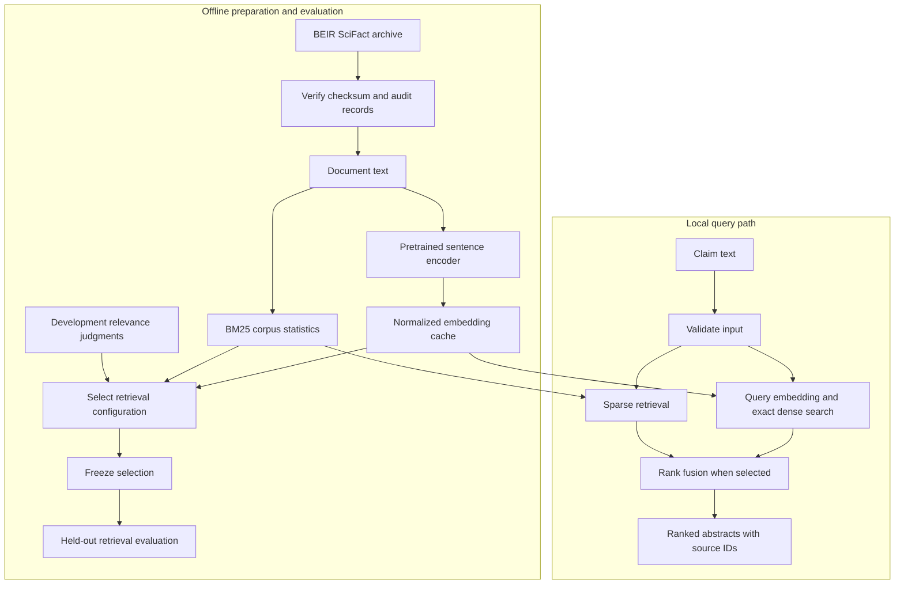

# System design

## 1. The decision being supported

A researcher enters a short scientific claim and wants a ranked shortlist of abstracts worth reading. EvidenceLens searches a fixed benchmark corpus and returns document IDs, titles and source text. It does **not** decide whether the claim is true, generate a medical recommendation, or assert that a retrieved paper supports the claim.

A relevant abstract may **contradict** the input. Conversely, a high semantic similarity score can come from shared subject matter without bearing on the specific claim. The interface must preserve this distinction rather than use green “verified” labels.

## 2. Implemented local architecture

The experiment compares sparse, dense and fused results. Selection is based on development labels, not the final retrieval test results. No model fine-tuning is implied by constructing a corpus index.

The repository's Python modules and saved configuration are the source of truth for parameter names and cache formats. The diagram is a data-flow summary, not a claim that each box runs as a separate deployed service.

## 3. Retrieval choices

### BM25

Lexical matching handles precise biomedical terms, identifiers and exact phrase vocabulary. It can miss paraphrases and synonyms. Corpus document frequencies are calculated over the searchable collection; this is normal retrieval indexing, not using relevance labels from evaluation queries.

### Dense bi-encoder

A frozen MiniLM sentence encoder provides semantic matching. Document vectors are computed offline; queries are embedded at request time. L2 normalization lets a dot product act as cosine similarity. A dense score is not a probability that the claim is true.

Short-input encoders have a finite context window. Long abstracts may be truncated. Measure and disclose this; displaying the full abstract afterward does not mean the model encoded all of it. Chunking and pooling are possible next experiments, but require explicit document-level aggregation and evaluation.

### Reciprocal rank fusion

BM25 and cosine scores have incompatible scales. Rank fusion combines rank positions rather than treating raw scores as interchangeable. Its smoothing constant and candidate depth affect behavior. Choose these using development judgments, then hold them fixed for evaluation.

Hybrid is a candidate, not a guaranteed winner. If one retriever already dominates, mixing in the weaker ranking can hurt. Publish all measured results and deploy the development-selected configuration even if a different configuration looks better on the final test table.

## 4. Evaluation contract

- Index the complete corpus, not only documents known to contain evidence.
- Use BEIR training judgments as the development set for retrieval configuration selection.
- Do not use final test judgments for feature choices, fusion weights or model selection.
- Evaluate all final test queries, including misses, with nDCG@10, reciprocal rank at 10 and recall at the declared cutoffs.
- A query without a hit must contribute zero rather than disappear from the average.
- Recall divides by all judged relevant documents for that query, not by the number retrieved.
- Duplicate document IDs must not inflate credit.
- Disclose ties and ranking stability, query overlap and incomplete relevance judgments.
- Inspect individual misses and rank regressions, not only mean metrics.

Relevant-document retrieval is narrower than claim verification. The benchmark does not establish clinical validity, coverage of the scientific literature, or correctness of generated answers. There is no generated answer in the implemented query path.

## 5. Cache correctness

Embeddings are derived artifacts. Their identity depends on ordered document IDs/text, model revision, preprocessing and encoding settings. A cache must not silently pair vectors with a differently ordered corpus or a new model revision. Validate metadata and array dimensions before reuse; regenerate stale caches.

A checksum on the source archive is not sufficient if mutable extracted files are accepted without validation. The download/loading path must maintain the relationship between the verified source and indexed text.

## 6. Why exact search first?

The benchmark collection is small enough to compare a query vector with every document vector directly. Exact search keeps retrieval deterministic and avoids an approximate-nearest-neighbor recall tradeoff while establishing a quality baseline.

A vector database becomes useful when measured corpus size, filtering requirements, update frequency or concurrency justify it. Introducing one without those requirements adds an operational dependency rather than demonstrated retrieval quality.

## 7. Proposed deployment extensions — not implemented

For a larger internal research collection:

1. **Ingestion workers:** parse incoming documents, retain publisher identifiers, validate permissions and record source versions. OCR quality and abstract/full-text differences need separate checks.
2. **Versioned indexes:** build sparse and dense indexes for one corpus snapshot. Swap the serving pointer only after evaluation; retain the prior snapshot for rollback.
3. **Authenticated query API:** validate input size and rate limits. Apply document permissions before exposing titles, snippets or cached results. Neither a model nor a query prompt is an authorization boundary.
4. **Retrieval workers:** separate query encoding from index access if profiling shows that batching or accelerator sharing improves throughput. Apply deadlines, bounded concurrency and cancellation.
5. **Observability:** track stage latency, cold loads, cache failures, empty results and reviewed retrieval quality. Avoid logging sensitive research queries by default.
6. **Human review:** let readers inspect original evidence, relevance and provenance. Feedback collection should not automatically convert a click into a gold relevance judgment.

A future answer generator would be a separate component with citation correctness, unsupported-claim and prompt-injection evaluations. It must treat retrieved text as untrusted source material, not as executable instructions. That extension is outside this implementation.

## 8. Failure modes and responses

| Failure | Current interpretation / appropriate response |
|---|---|
| No useful evidence among top results | Report retrieval failure; do not infer that the claim is false |
| Contradictory evidence retrieved | Still potentially a successful retrieval; inspect the paper |
| High score on wrong biomedical relation | Analyze as a relevance error; similarity is not entailment |
| Long abstract truncated | Disclose encoder limit and evaluate a chunked alternative before claiming full-text coverage |
| Benchmark versus current research drift | Build a separate dated evaluation set before deployment |
| Stale or malformed embedding cache | Reject or rebuild; never silently use mismatched vectors |
| Upstream model/data download unavailable | Fail clearly; use a previously verified local cache only if available |
| Misleading document citation link | Show the verified dataset identifier; do not invent publisher URLs |

## 9. Reproducibility and scope

Pin data integrity and model revision; record dependency versions, configuration and query counts. Distinguish cold index construction, warm retrieval, query embedding and total request time. Hardware-specific timings are measurements of this run, not a service-level objective.

See [sources and licenses](sources-and-licenses.md) for the original component licenses and the distinction between BEIR's labeled retrieval test set and SciFact's hidden verification test.
